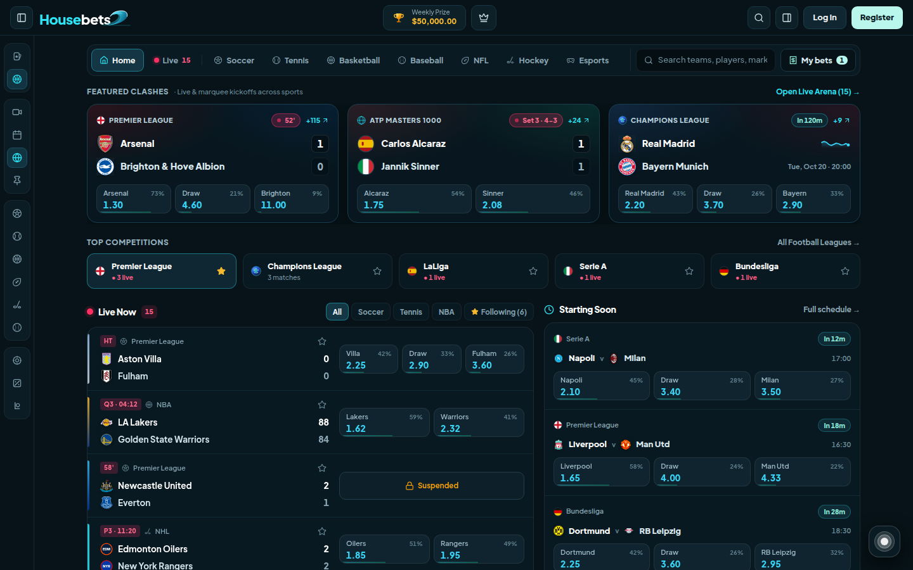
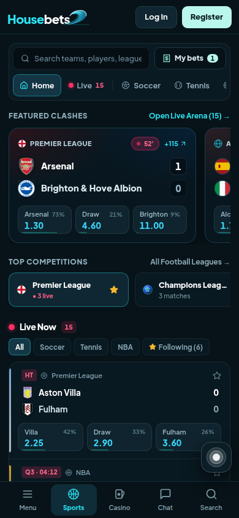
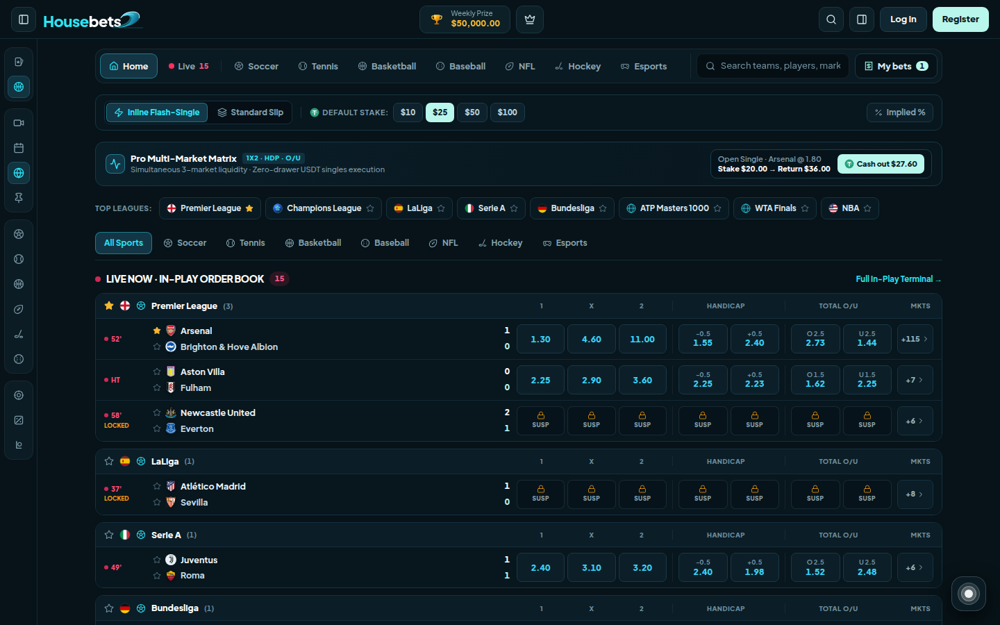
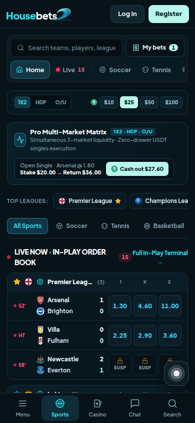
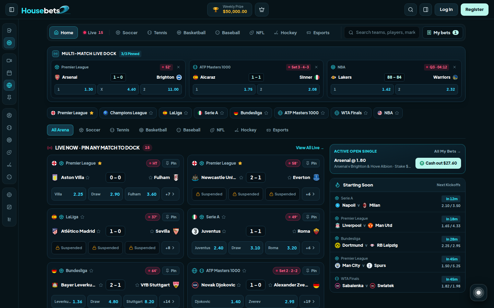
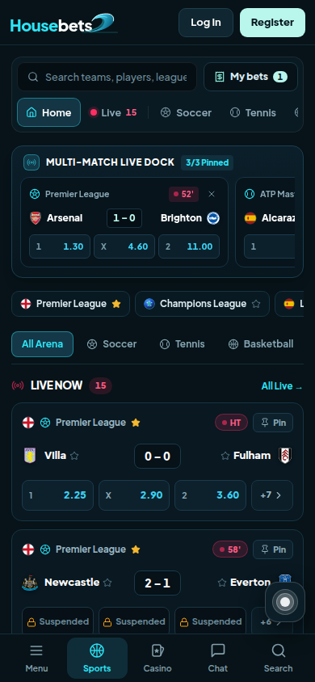

# Housebets Sportsbook — 3 Standalone UI/UX Design Editions

[](https://housebets-desk.pages.dev)
[](https://housebets-matrix.pages.dev)
[](https://housebets-arena.pages.dev)

This repository contains **three complete, standalone sportsbook UI/UX architectures** designed for **Housebets**. Rather than reskinning a single layout, each edition rethinks how crypto-native **USDT single-bet players** discover markets, read prices, and execute in-play bets—while staying 100% faithful to the Housebets dark-teal shell, 5-page structure, `1440px` desktop & `390px` mobile viewports, and full edge-case state handling.

---

## 🧭 At-a-Glance: Comparing the 3 Designs

| Dimension | **Design 01 — Trading Desk** | **Design 02 — Pro Matrix** | **Design 03 — Live Arena** |
| :--- | :--- | :--- | :--- |
| **Live URL** | **[housebets-desk.pages.dev](https://housebets-desk.pages.dev)** | **[housebets-matrix.pages.dev](https://housebets-matrix.pages.dev)** | **[housebets-arena.pages.dev](https://housebets-arena.pages.dev)** |
| **Target Player Persona** | Sharp & analytical crypto bettors | High-volume Asian/Pinnacle-style grinders | Multi-screen in-play & social casino bettors |
| **Primary Odds Presentation** | `1X2` cards/rows with **embedded Implied Probability (`%`) bars** & mini sparklines | **Simultaneous 3-Market Grid** (`1X2 · HDP · O/U` side-by-side on every row) | **2-Column Arena Cards** with `Pin` controls + persistent **Multi-Match Live Dock** |
| **Signature Betting Flow** | Decimal ↔ Implied `%` odds lens + interactive **Odds Price Terminal Chart** on Match Page | **⚡ Inline Flash-Single** (`$10/$25/$50/$100` USDT zero-drawer execution) vs. Standard Slip | **Pin up to 3–4 Live Matches** into a top dock + **Live Bet-Stream** 1-click copy-single |
| **Mobile (`390px`) Adaptation** | Compact implied-prob odds buttons + bottom Bet Slip bar & drawer | Smart `1X2 \| HDP \| O/U` mobile column switcher + quick Flash Stake bar | Swipable pinned Live Dock strip + compact Arena cards + bottom Bet Slip bar |
| **Build Script** | `npm run build:sub1` (`dist-sub1/`) | `npm run build:sub2` (`dist-sub2/`) | `npm run build:sub3` (`dist-sub3/`) |

---

## 🎯 Design 01 — Implied-Odds Trading Desk
🔗 **Live Prototype:** **[https://housebets-desk.pages.dev](https://housebets-desk.pages.dev)**

<table>
  <tr>
    <td width="72%" valign="top">
      
      <p align="center"><sub><b>Desktop (1440px)</b> — Featured Clashes with implied probability bars & dual Live / Starting Soon feed</sub></p>
    </td>
    <td width="28%" valign="top">
      
      <p align="center"><sub><b>Mobile (390px)</b> — Native compact shell & bottom Bet Slip bar</sub></p>
    </td>
  </tr>
</table>

### Big Idea
Housebets players are crypto-native traders used to probabilities, orderbooks, and price charts. **Trading Desk** surfaces the true **implied probability (`%`)** alongside decimal odds on every button, adds **mini price-history sparklines** on marquee fixtures, and equips the Match Page with an interactive **Odds Price Terminal Chart** so players can read market momentum before placing a USDT single.

### Design-Specific Highlights (`src/pages/*` + `src/components/OddsSparkline.tsx`)
- **Featured Clashes Hero Grid:** Live & upcoming marquee fixtures across Soccer, Tennis, and Champions League with inline probability fill bars (e.g., `Arsenal 73% · 1.30`).
- **Split Discovery Layout:** Side-by-side *Live Now* in-play feed and *Starting Soon* countdown schedule on Sports Home.
- **Match Page Terminal:** Club-colored SVG price movement chart, market pinning (`Pin` favorite market groups to top), collapsible market accordions, and instant market search.

---

## ⚡ Design 02 — Pro Multi-Market Matrix & Flash-Singles
🔗 **Live Prototype:** **[https://housebets-matrix.pages.dev](https://housebets-matrix.pages.dev)**

<table>
  <tr>
    <td width="72%" valign="top">
      
      <p align="center"><sub><b>Desktop (1440px)</b> — Simultaneous 1X2 · Handicap · Total O/U orderbook grid + Flash-Single toolbar</sub></p>
    </td>
    <td width="28%" valign="top">
      
      <p align="center"><sub><b>Mobile (390px)</b> — 1X2 / HDP / O/U column switcher + Flash Stake presets</sub></p>
    </td>
  </tr>
</table>

### Big Idea
Traditional sportsbooks hide Handicaps and Totals behind extra clicks and force every single bet through a side drawer. **Pro Matrix** puts all three core liquid markets (**`1X2` · `Asian Handicap` · `Total O/U`**) onto a single high-density row and introduces **⚡ Inline Flash-Single** mode—allowing players to pre-select a USDT stake (`$10`, `$25`, `$50`, `$100`) and execute singles directly in-place without opening a drawer.

### Design-Specific Highlights (`src/editions/matrix/*`)
- **Simultaneous 3-Market Table (`MatrixMatchTable.tsx`):** Compare full-time result, spread/handicap line, and goal/point totals across leagues in one glance.
- **Dual Execution Toolbar (`FlashStakeToolbar.tsx`):** Switch seamlessly between **⚡ Inline Flash-Single** (1-click inline confirmation) and **Standard Slip** mode, plus global `% Implied %` odds formatting.
- **Top Position & Quick Cash-Out Strip:** Displays the active open USDT single right above the matrix with 1-click **`Cash out $XX.XX`** settlement.
- **Responsive Mobile Column Switcher:** Keeps `390px` phone rows clean and tap-friendly by toggling `1X2`, `HDP`, or `O/U` columns on demand.

---

## 📡 Design 03 — Multi-Match Live Arena & Casino Bet-Stream
🔗 **Live Prototype:** **[https://housebets-arena.pages.dev](https://housebets-arena.pages.dev)**

<table>
  <tr>
    <td width="72%" valign="top">
      
      <p align="center"><sub><b>Desktop (1440px)</b> — Persistent 3/3 Multi-Match Live Dock + 2-column Arena cards + Quick Cash-Out</sub></p>
    </td>
    <td width="28%" valign="top">
      
      <p align="center"><sub><b>Mobile (390px)</b> — Swipable pinned Live Dock + touch-first Arena cards</sub></p>
    </td>
  </tr>
</table>

### Big Idea
Live bettors never watch just one match—and on a crypto casino like Housebets, betting is inherently fast and social. **Live Arena** introduces a persistent **Multi-Match Live Dock** where players can pin up to 3–4 live games across Soccer, Tennis, and NBA to monitor scores and fire `1X2` singles from anywhere in the app, paired with a real-time **Community Bet-Stream** to copy sharp USDT singles in one tap.

### Design-Specific Highlights (`src/editions/arena/*`)
- **Multi-Match Live Dock (`MultiMatchLiveDock.tsx`):** Pin/unpin any live fixture (`Pin` button on every card) to keep live clocks, scores, and `1X2` buttons docked at the top of Home, Live, Football, and Match pages.
- **Dual-Match Split View on Match Page (`ArenaMatchPage.tsx`):** Monitor a secondary pinned live match alongside the primary Match Page market board.
- **Casino-Style Live Bet-Stream (`CasinoLiveBetStream.tsx`):** Live ticker of high-conviction USDT single bets placed by the Housebets community with instant **`Copy Single`** into the player's slip.

---

## ✅ Shared Core Requirements Across All 3 Designs

Every standalone build implements the complete **5-page journey**, **Housebets shell**, **Singles-Only USDT rules**, and **100% edge-case state coverage**:

### 1. All 5 Linked Pages
1. **Sports Home:** *Live Now*, *Starting Soon*, *Top Competitions*, *Sports Nav*, and instant search across **teams, players, competitions, and markets**.
2. **Live:** Every match in play with live score & ticking match clock, sport/competition filters, and graceful **Nothing Live → Starting Soon** empty-state fallback.
3. **Football:** Full **Premier League, Champions League, LaLiga, Serie A, and Bundesliga** coverage with match result odds on every row and **`★ Follow`** for teams & competitions.
4. **Match Page:** Live scoreboard & clock (e.g., *Arsenal v Brighton*), complete market groups (**Popular, Goals, Halves, Handicaps, Goalscorers, Corners & Cards**), live moving odds, and market suspensions.
5. **Bet Slip + My Bets (Shared Single Page / Side Panel):** Tap odds to add to slip, **Singles Only**, decimal odds, stakes in **USDT** (`Stake`, `Odds`, `Potential Return`), **My Bets** (*Open* & *Settled*), and instant **Cash Out**.

### 2. Every Edge-Case State (`Suspended`, `Changed`, `Failed`)
Testable organically as odds tick live—or on-demand via the floating **QA State Simulator Orb** in the bottom-right corner:
- **Moving Odds:** Directional green/red price flashes on live market updates.
- **Odds Changed in Slip:** Halts immediate submission and requires explicit player confirmation (**`Accept Odds Changes`**).
- **Selection / Market Suspended:** Displays clear `Locked / Suspended` badges on rows, market groups, and slip items while preventing invalid placement.
- **Bet Placed & Bet Failed:** Complete placement lifecycle with USDT receipt confirmation as well as simulated **Bet Failed** recovery (*Retry* / *Remove*).

---

## 🛠️ Tech Stack & Repository Layout

- **Frontend:** React 18, TypeScript, Vite 5
- **Styling & Motion:** Tailwind CSS, Framer Motion, Lucide Icons
- **Hosting:** Cloudflare Pages (`housebets-desk`, `housebets-matrix`, `housebets-arena`)

```text
housebet-ui/
├── docs/previews/             # Desktop (1440px) & Mobile (390px) screenshots of all 3 designs
├── public/
│   ├── brand/                 # Housebets brand logo & visual pack
│   └── crests/                # Sample club & competition crests
├── src/
│   ├── components/            # Shared Housebets shell, BetSlip + MyBets, OddsButton, QA State Orb
│   ├── config/edition.ts      # Compile-time lock (VITE_EDITION) & dev URL switcher (?edition=)
│   ├── context/               # Unified sportsbook state, live odds engine, USDT slip & cash-out
│   ├── data/                  # Sample fixtures, leagues, and deep match market generators
│   ├── pages/                 # Design 01 (Trading Desk) pages: Home, Live, Football, Match
│   └── editions/
│       ├── matrix/            # Design 02 (Pro Matrix): 3-market table, FlashStakeToolbar, pages
│       └── arena/             # Design 03 (Live Arena): MultiMatchLiveDock, BetStream, pages
└── package.json
```

---

## 🚀 Local Development & Building Each Design

```bash
# Install dependencies
npm install

# Run local dev server (switch between the 3 designs via URL query parameter)
npm run dev
#   Design 01 (Trading Desk) -> http://localhost:5173/?edition=desk
#   Design 02 (Pro Matrix)   -> http://localhost:5173/?edition=matrix
#   Design 03 (Live Arena)   -> http://localhost:5173/?edition=arena

# Type-check all 3 editions
npx tsc --noEmit

# Build standalone locked production bundles (used for the 3 Cloudflare Pages links)
npm run build:sub1   # Design 01 -> dist-sub1/
npm run build:sub2   # Design 02 -> dist-sub2/
npm run build:sub3   # Design 03 -> dist-sub3/
```

---

## 📌 Prototype Scope Notice

- **Singles Only:** No multiples, accumulators, bet builders, boosts, or free bets.
- **Sample Data Only:** Front-end interactive prototype using synthetic fixtures, simulated live clocks/odds, and mock USDT balances (no real player data or real money).
